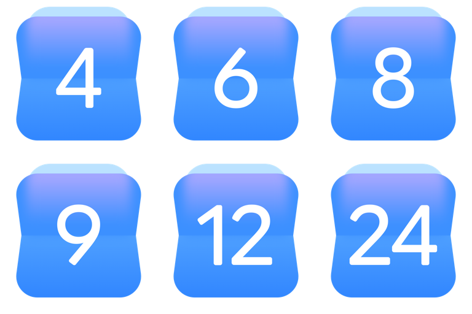

# not31

Make your **Google Calendar** macOS Dock icon show **today's date — not `31`**.

By default, installing Google Calendar as a macOS web app / PWA (in Chrome, Brave, Edge, Arc, Vivaldi, or Safari "Add to Dock") pins a static **`31`** icon in your Dock. **`not31`** replaces that static icon with **today's actual date (`1`–`31`)** rendered in Google's 2026 Calendar style and keeps it updated automatically every day.



## Features

- **Zero External Dependencies**: Pure native Swift (`AppKit` + `CoreGraphics` + `CoreImage`) with embedded vector glyph outlines (`1`–`31`) and vector card artwork. No Python, Node, Homebrew, internet connection, or extra fonts required.
- **Preserves Code Signatures & Notifications**: Applies the icon via `NSWorkspace.setIcon` rather than mutating `Contents/Resources/app.icns`, keeping Chromium's `AppShimRegistry` `cdhash` verification and macOS notification permissions completely intact.
- **Native macOS Appearance Support**: Passes each generated glyph through macOS `IconServices` so Light Mode, Dark Mode, and macOS Liquid Glass squircles match neighboring Dock icons automatically.
- **Zero-Polling Background Agent**: Event-driven LaunchAgent wakes only on:
  - Local midnight rollover (`NSCalendarDayChanged`)
  - Wake from overnight sleep (`NSWorkspace.didWakeNotification`)
  - Timezone or clock changes while traveling
  - Light ↔ Dark Mode toggles
  - Browser updates that rebuild the PWA bundle
- **Auto-Detection Across Browsers**: Automatically finds Google Calendar PWAs pinned in your Dock or installed in `~/Applications` / `/Applications` (supports multiple profiles, e.g. Work + Personal).

## Requirements

- macOS 13 (Ventura) or newer (Apple Silicon & Intel Universal)
- Google Calendar installed as a Dock web app:
  - **Chrome / Brave / Edge**: Open `https://calendar.google.com` → Browser Menu → **Cast, save, and share** → **Install Google Calendar...**
  - **Safari**: Open `https://calendar.google.com` → **File** → **Add to Dock...**

## Quick Install

### Option 1: One-Line Terminal Install (No Dev Tools Needed)

Downloads the precompiled Universal (`arm64` + `x86_64`) release, installs `~/.local/bin/not31`, enables the background LaunchAgent, and updates your Dock icon immediately:

```bash
curl -fsSL https://raw.githubusercontent.com/vcdx71/not31/main/install.sh | bash
```

### Option 2: Double-Clickable macOS Installer (`.pkg`)

Download **`not31-1.0.0.pkg`** from [Releases](https://github.com/vcdx71/not31/releases/latest) and open it in Finder.

### Option 3: Build from Source

```bash
git clone https://github.com/vcdx71/not31.git
cd not31
./install.sh
```

### Custom App Bundle Path

If you use a custom wrapper (Fluid, Unite, Coherence, WebCatalog) stored in a non-standard location:

```bash
./install.sh --app "/Applications/My Calendar.app"
```

## CLI Usage

Once installed (`~/.local/bin/not31`):

```bash
# Show detected Google Calendar apps, current day/appearance, and daemon status
not31 status

# Force an immediate refresh or preview a specific date (1..31)
not31 update --force
not31 update --day 24

# List auto-detected Google Calendar web app bundles
not31 detect

# Temporarily revert to the static '31' icon without uninstalling
not31 reset

# Completely remove the LaunchAgent, state files, CLI, and restore the '31' icon
not31 uninstall
```

## Building Distribution Artifacts

```bash
# Build Universal (arm64 + x86_64) binary
make universal

# Build standalone universal release tarball in dist/
make release

# Build macOS .pkg installer in dist/
make pkg
```

## License

MIT License — see [LICENSE](LICENSE). Vector digit outlines derived from Google Sans Flex (SIL Open Font License 1.1).
